# Helpr — How MSFLib Is Used, End to End

Diagrams of every place MSFLib does real work in Helpr: frontend, backend, payments,
notifications and uploads. Each section lists the files it was drawn from. MSFLib APIs shown
here are the ones recorded in [`msflib-facts.md`](msflib-facts.md); if code and this file
disagree, the code and the facts register win, so update this file.

Last reviewed: 2026-10-09.

## 1. The whole picture

Which MSFLib package does what, on each side, and how they meet.

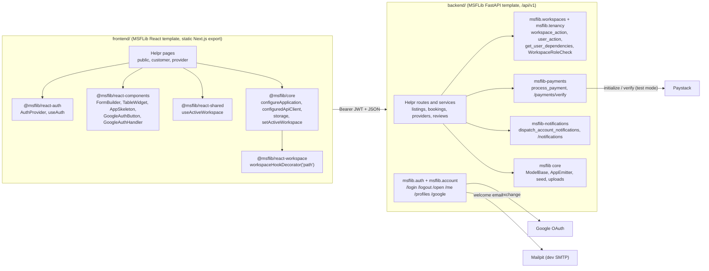

| Concern | Frontend (MSFLib) | Backend (MSFLib) | Helpr owns |
|---|---|---|---|
| Sign-up, login, session | `AuthProvider`, `useAuth` | `auth_router`, `account_router` | Form definitions |
| Google sign-in | `GoogleAuthButton`, `GoogleAuthHandler` | `/google/login`, `/google/callback` | `create_google_account` listener |
| Provider isolation | `workspaceHookDecorator('path')`, `setActiveWorkspace`, `useActiveWorkspace` | `get_user_dependencies`, `WorkspaceRoleCheck` | `ProviderProfile`, `get_provider_context` |
| Forms, tables, loading | `FormBuilder`, `TableWidget`, `AppSkeleton` | — | Form definitions and layouts |
| Payments | `configuredApiClient` (calls `/payments/verify`) | `process_payment`, `payments_router` | `start_payment`, `on_payment_verified` |
| Notifications | `configuredApiClient` (calls `/notifications`) | `dispatch_account_notifications`, `account_notification_router` | `notify_accounts`, `notify_after_commit` |
| Photos | — | `validate_upload`, `save_file_blob` | `provider_photo` service |
| Bookings, listings, reviews | — | `ModelBase` only | Everything else |

## 2. Startup: how each side wires MSFLib in

### 2.1 Frontend

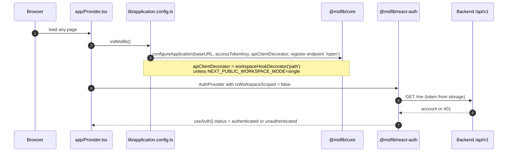

Files: `frontend/app/Provider.tsx`, `frontend/lib/application.config.ts`,
`frontend/utils/resolveWorkspace.ts`.

### 2.2 Backend

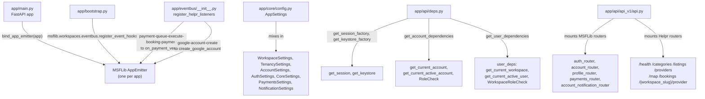

Listeners go on the **app** emitter, never the module-level default one (AGENTS.md §5).
The provider router is mounted last so `/{workspace_slug}` does not shadow fixed paths.

## 3. Sign-up, login, logout

All three are MSFLib on both ends; Helpr only supplies the form definitions and layouts.

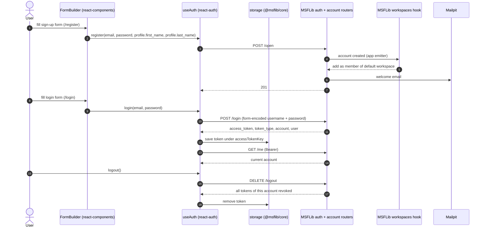

Files: `frontend/app/(auth)/login/components/Login.tsx`,
`frontend/app/(auth)/register/components/SignUp.tsx`, their `data/form/*.form.ts` and
`*.layout.tsx` files.

### 3.1 Google sign-in (ADR 0029)

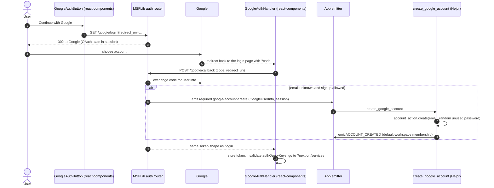

Settings: `ENABLE_GOOGLE_OAUTH`, `ALLOW_GOOGLE_OAUTH_SIGNUP`, `GOOGLE_OAUTH_CLIENT_ID`,
`GOOGLE_OAUTH_CLIENT_SECRET`, `GOOGLE_REDIRECT_URI`; the routes are 403 when disabled.

Files: `backend/app/services/google_auth.py`, `backend/app/eventbus/__init__.py`,
`frontend/app/(auth)/components/GoogleLoginButton.tsx`,
`frontend/app/(auth)/login/components/GoogleCallback.tsx`.

## 4. Becoming a provider (workspace creation)

A provider is an MSFLib **workspace** that has a Helpr `ProviderProfile` (ADR 0005).

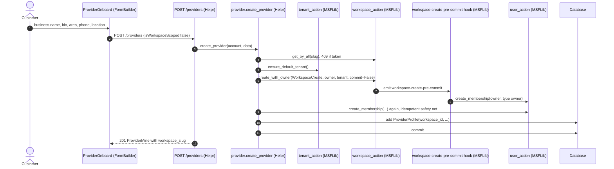

Files: `backend/app/services/provider.py`,
`frontend/app/(protected)/provider/onboard/components/ProviderOnboard.tsx`.

## 5. Provider area: workspace scoping across both sides

The frontend never writes the slug into URLs. It marks the provider client as scoped and
MSFLib inserts the active slug; the backend resolves the same slug and checks membership.

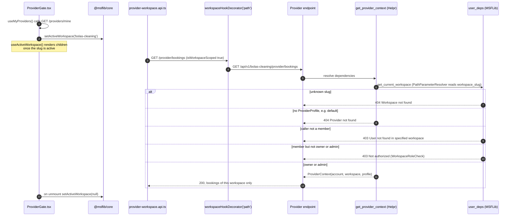

Only `provider-workspace.api.ts` is scoped. Every other API file passes
`isWorkspaceScoped: false`, so customer calls never get a slug.

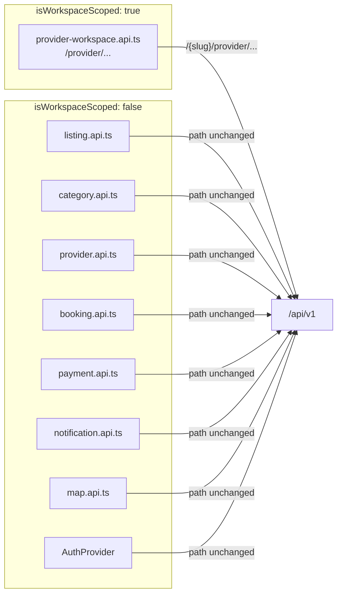

Files: `frontend/app/(protected)/provider/components/ProviderGate.tsx`,
`frontend/api/*.api.ts`, `backend/app/api/deps.py`,
`backend/app/api/api_v1/endpoints/provider_area.py`.

## 6. Booking lifecycle (Helpr) and where MSFLib plugs in

Only `BookingService.transition()` changes `booking.status` (ADR 0007). The `paid` step is
driven by msflib-payments; every arrow that says "notify" goes through msflib-notifications.

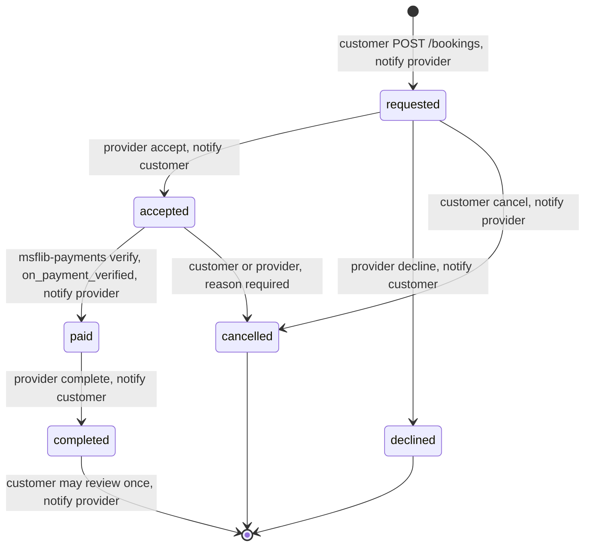

Invalid moves are 409, the wrong actor is 403. File: `backend/app/services/booking.py`.

## 7. Payment, end to end (msflib-payments + Paystack test mode)

### 7.1 Sequence

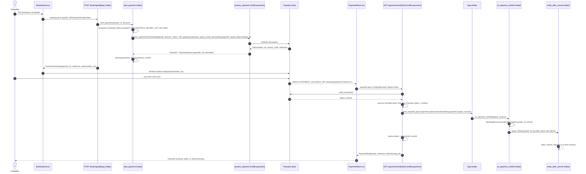

### 7.2 Rules this flow enforces

| Rule | Where |
|---|---|
| Only the booking's customer can pay | `get_customer_booking` → 403 |
| Only an `accepted` booking can be paid | `start_payment` → 409 |
| Payments must be configured | `start_payment` → 503 |
| Paystack initiation failure rolls back | `start_payment` → 502 |
| Amounts go to `process_payment` in major units (kobo / 100) | `start_payment` |
| Paystack amount must match the stored amount | msflib-payments verify → 400 |
| Only the paying account can verify or read a payment | msflib-payments router → 401 / 404 |
| The listener must not commit; the verify route commits | `on_payment_verified` |
| A booking no longer `accepted` is not moved to `paid` (payment is noted) | `on_payment_verified` |
| Re-verifying a `verified` payment whose queue is still `queued` re-runs the listener without calling Paystack | msflib-payments router |
| Test keys only; no payouts, refunds or webhooks | ADR 0019 |
| `AppPaymentNotice` shown wherever payment appears | `BookingView`, `PaymentReturn` |

### 7.3 Payment data

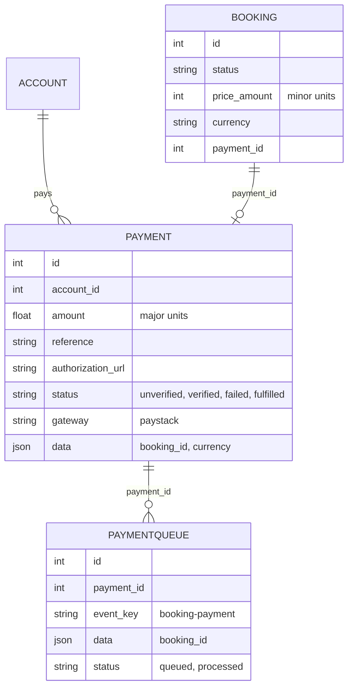

`PAYMENT` and `PAYMENTQUEUE` are msflib-payments tables; `BOOKING` is Helpr's.

Settings (flat names in `backend/.env`): `PAYMENT_GATEWAY=paystack`,
`PAYMENT_CALLBACK_URL=http://localhost:3000/bookings/payment`, `PAYSTACK_BASE_URL`,
`PAYSTACK_SECRET_KEY` (test key).

Files: `backend/app/services/booking.py`, `backend/app/eventbus/__init__.py`,
`frontend/api/booking.api.ts`, `frontend/api/payment.api.ts`, `frontend/hooks/booking.hooks.ts`,
`frontend/app/(protected)/bookings/view/components/BookingView.tsx`,
`frontend/app/(protected)/bookings/payment/components/PaymentReturn.tsx`.

## 8. In-app notifications (msflib-notifications)

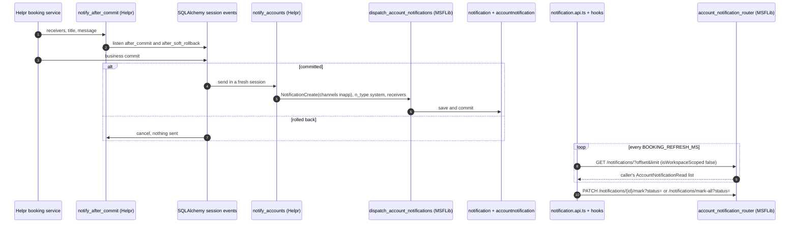

| Event | Who is notified |
|---|---|
| Booking requested, cancelled by customer, paid, reviewed | Provider workspace owner and admins (`provider_managers`) |
| Booking accepted, declined, cancelled by provider, completed | The booking's customer |

Dispatch commits, so it never runs inside a lifecycle pre-commit hook or directly in the
payment listener (ADR 0021).

Files: `backend/app/services/notification.py`, `backend/app/services/booking.py`,
`frontend/api/notification.api.ts`, `frontend/hooks/notification.hooks.ts`.

## 9. Provider photos (msflib core uploads, ADR 0027)

Backend only so far; the frontend does not call these routes yet.

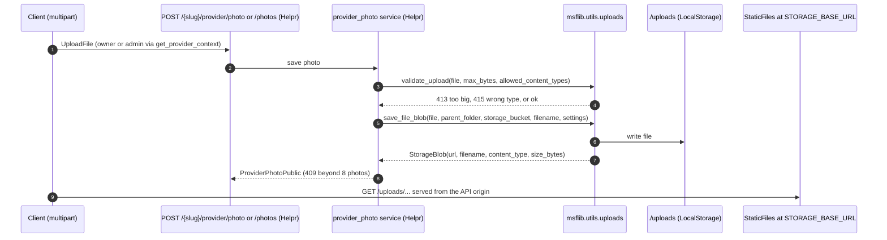

When the frontend adds this, it should send the file with
`configuredApiClient({ isWorkspaceScoped: true }).apiFormDataClient(...)` from a `FormBuilder`
field with `eType: 'upload'` (both recorded in `msflib-facts.md`).

Files: `backend/app/services/provider_photo.py`,
`backend/app/api/api_v1/endpoints/provider_area.py`.
