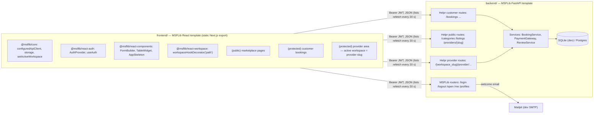
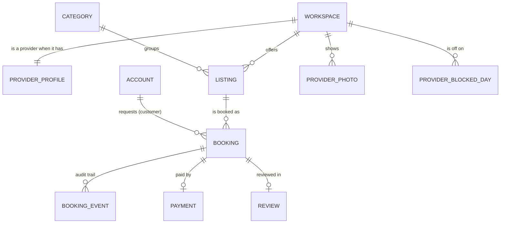

# Helpr — Product and Technical Proposal

Status: Proposed · Date: 2026-10-09 · Owner: Godspower Ufot

## 1. Summary

Helpr is a two-sided marketplace for local services. Customers discover services, compare
providers on price and verified reviews, request a booking, and follow it from request to
completion. Providers publish listings, accept or decline requests, complete jobs, and see a
simple earnings summary.

Helpr is built entirely on the MSFLib stack: the MSFLib FastAPI template for the backend and
the MSFLib React template (`@msflib/*` packages) for the frontend, using only what the
templates ship. Identity, accounts and provider isolation (workspaces) come from MSFLib on
both sides; the marketplace (listings, bookings, payments, reviews, booking updates) is our
own domain. Customers pay through `msflib-payments` with Paystack in test mode (ADR 0019); provider payouts are manual.

**Product principle:** build a trustworthy service-booking experience, not a set of CRUD
screens. The UI is editorial, dark and minimal (ADR 0018): full-bleed photography and large
type sell the services on public pages; the booking and provider screens stay quiet. All UI
meets Vercel's Web Interface Guidelines.

## 2. Problem

Finding a reliable plumber, cleaner or technician usually means word-of-mouth and phone
calls. Customers cannot compare prices, see verified feedback, or tell where a job stands.
Providers juggle requests across WhatsApp and calls, with no record of what was agreed.

## 3. Users

| Persona | Goal | Key moments |
|---|---|---|
| Customer (Ada, Lagos) | Get a job done by someone trustworthy at a clear price | Browse → compare → request → pay → review |
| Provider (Bola's Cleaning) | Fill the calendar without phone tag | Publish listing → accept → complete → see earnings |
| Visitor | Decide whether Helpr is worth signing up for | Browse without an account |

One account can be both a customer and a provider (ADR 0004).

## 4. Scope

**MVP (this build):** discovery, listing detail, provider profile, sign-up/login, booking
request, provider accept/decline, Paystack test payment, completion, review, booking timeline
with auto-refreshing "needs action" counts, provider listings management, provider bookings
inbox, earnings summary, in-app activity notifications (ADR 0021), one service region (Eket)
with provider coordinates, nearby search and a services map (ADR 0022, map rendering ADR 0025),
provider business and work photos (ADR 0027) and provider days off that block bookings (ADR 0028).
Full breakdown and acceptance criteria: [`MVP.md`](MVP.md).

**Not in the MVP:** real payments, email/SMS notifications, refunds and disputes, chat, provider calendars,
weekly hours and time slots (only whole days off, ADR 0028), more than one service region, provider verification/KYC, admin console beyond
MSFLib's admin accounts routes, mobile apps.

## 5. MSFLib boundary

| Capability | Source | Evidence |
|---|---|---|
| Sign-up, login, logout, password reset, current account | MSFLib auth + account (template) | Facts register: Identity |
| Profiles | MSFLib account (template) | Documented |
| Provider business, membership and roles, request-time isolation | MSFLib workspaces + auth `get_user_dependencies` | Verified (runtime), `test_provider_area.py`; ADR 0005 step 5 (frontend) open |
| Welcome email on sign-up | MSFLib account (template) | Documented |
| Frontend session, login, sign-up, logout | `@msflib/react-auth` (`AuthProvider`, `useAuth`) | Documented + Verified (code) |
| Frontend HTTP, token storage, provider workspace scoping | `@msflib/core` + `@msflib/react-workspace` (`workspaceHookDecorator('path')`) | Verified (code) |
| Every form and table | `@msflib/react-components` (`FormBuilder`, `TableWidget`) | Documented |
| Paystack checkout and verification | `msflib-payments` | ADR 0019 |
| Activity notifications inbox (`/notifications`) | `msflib-notifications`, in-app channel | ADR 0021 |
| Provider photo storage (validate, save, delete, `/uploads` static serving) | MSFLib core `msflib.utils.uploads` + template `StaticFiles` mount; frontend `apiFormDataClient` | ADR 0027 |
| Categories, listings, bookings, booking events, reviews, earnings | **Helpr (custom)** | ADRs 0006–0011 |

Constraint: only what the two MSFLib templates ship is used (ADR 0015, 0016).

Rule: we reuse MSFLib only through APIs listed in [`msflib-facts.md`](msflib-facts.md). We do
not invent MSFLib methods or endpoints.

## 6. Architecture

Authorization layers:

| Route group | Dependency | Who passes |
|---|---|---|
| Public | none / `get_current_account_or_none` | Everyone |
| Customer | `get_current_active_account` + ownership check on the booking | The booking's customer |
| Provider | `user_deps.get_current_workspace` + `get_current_active_user` + `WorkspaceRoleCheck([owner, admin])` + `ProviderProfile` exists | Owner/admin members of that provider workspace |

## 7. Data model (Helpr tables)

`ACCOUNT` and `WORKSPACE` are MSFLib tables; the rest are ours.

| Table | Key fields | ADR |
|---|---|---|
| `providerprofile` | `workspace_id` (unique), `display_name`, `bio`, `service_area`, `phone`, `latitude`, `longitude`, `rating_avg`, `rating_count` | 0005, 0022 |
| `category` | `slug` (unique), `name`, `icon` | 0006 |
| `listing` | see ADR 0006 | 0006 |
| `booking` | `listing_id`, `provider_workspace_id`, `customer_account_id`, `status`, `scheduled_for`, `address`, `notes`, `latitude`, `longitude` (optional job site), `price_amount`, `currency`, `payment_id`, timestamps | 0007, 0022 |
| `bookingevent` | `booking_id`, `from_status`, `to_status`, `actor_account_id`, `actor_role`, `reason`, `created_at` | 0007 |
| `payment` | MSFLib `msflib-payments` table (`reference`, `authorization_url`, `status`, `gateway`, `amount`, `data`). Helpr links it with `booking.payment_id` | 0019 |
| `review` | `booking_id` (unique), `listing_id`, `provider_workspace_id`, `customer_account_id`, `rating`, `comment` | 0010 |
| `providerphoto` | `provider_workspace_id`, `kind` (`profile` \| `work`), `url`, `caption`, storage locator (`storage_method`, `parent_folder`, `storage_bucket`, `filename`), `content_type`, `size_bytes` | 0027 |
| `providerblockedday` | `provider_workspace_id`, `day` (Africa/Lagos date), `note`; unique (`provider_workspace_id`, `day`) | 0028 |

## 8. API contracts

All under `/api/v1`. Money in minor units. Errors use FastAPI's shape: `{"detail": "..."}` or
a 422 `detail` array.

### MSFLib (existing)

| Method | Path | Notes |
|---|---|---|
| POST | `/open` | Sign up. `{email, password, profile: {first_name, last_name}}` → 201 |
| POST | `/login` | Form: `username`, `password` → `{access_token, token_type, ...}` |
| DELETE | `/logout` | Revokes the account's tokens |
| GET / PUT | `/me` | Current account |
| GET | `/payments/verify/{reference}` | `msflib-payments`: verifies with Paystack, fires `payment-queue-execute-booking-payment` (ADR 0019) |
| GET | `/payments/{payment_id}` | `msflib-payments`: payment owned by the caller |
| GET | `/notifications/` | `msflib-notifications`: the caller's inbox (`offset`, `limit`) |
| GET, DELETE | `/notifications/{id}` | `msflib-notifications`: one of the caller's notifications |
| PATCH | `/notifications/{id}/mark?status=` | `msflib-notifications`: mark read/unread |
| PATCH | `/notifications/mark-all?status=` | `msflib-notifications`: mark all read/unread |

### Public (Helpr)

| Method | Path | Response |
|---|---|---|
| GET | `/health` | `{status, service, checks: {database, default_tenant, default_workspace, keystore}}`; 503 when degraded |
| GET | `/categories` | `CategoryPublic[]` |
| GET | `/listings?category=&q=&area=&sort=price_asc\|price_desc\|rating\|distance&lat=&lng=&radius_km=&limit=&offset=` | `{items: ListingCard[], total}`; with `lat`/`lng`, only listings within `radius_km` and each card has `distance_km`; `sort=distance` needs a point (422 otherwise) |
| GET | `/listings/{id}?lat=&lng=` | `ListingDetail` (with `provider: ProviderPublic`, `distance_km` when a point is given) |
| GET | `/listings/{id}/reviews?limit=&offset=` | `{items: ReviewPublic[], total}` |
| GET | `/providers/nearby?lat=&lng=&radius_km=&category=` | `ProviderPin[]` nearest first (`distance_km`, `categories`, `listings`) |
| GET | `/providers/{slug}` | `ProviderDetail` with published listings, recent reviews, `photo_url` and work `photos` |
| GET | `/providers/{slug}/blocked-days` | `date[]`: the provider's blocked days for the next 180 days (no notes) |
| GET | `/map/config` | `MapConfig`: region name, centre, bounds, zoom limits, tile settings, default/max radius (ADR 0022) |

Points outside the service region are 422 "Helpr is only available in Eket for now.";
`radius_km` is capped at `NEARBY_MAX_RADIUS_KM`.

### Customer (auth required)

| Method | Path | Body | Result |
|---|---|---|---|
| POST | `/providers` | `{display_name, bio, service_area, phone, latitude?, longitude?}` | 201 `ProviderMine` (become a provider; slug derived from the name, 409 if taken) |
| GET | `/providers/mine` | | Provider businesses I own or administer |
| POST | `/bookings` | `{listing_id, scheduled_for, address, notes, latitude?, longitude?}` | 201 `BookingDetail` (`requested`) |
| GET | `/bookings/mine?status=` | | My bookings as a customer |
| GET | `/bookings/{id}` | | Customer of the booking only |
| POST | `/bookings/{id}/cancel` | `{reason}` | ADR 0007 rules |
| POST | `/bookings/{id}/pay` | | `PaymentCheckout {payment_id, reference, authorization_url}` for an `accepted` booking; booking becomes `paid` after verify (ADR 0019) |
| POST | `/bookings/{id}/review` | `{rating, comment}` | 201 `ReviewPublic` |

### Provider (owner/admin of `{workspace_slug}`)

| Method | Path | Result |
|---|---|---|
| GET | `/{workspace_slug}/provider` | `ProviderMine` (profile + stats) |
| PATCH | `/{workspace_slug}/provider` | Update profile |
| GET / POST | `/{workspace_slug}/provider/listings` | List all statuses / create (`draft`) |
| PATCH | `/{workspace_slug}/provider/listings/{id}` | Edit |
| POST | `/{workspace_slug}/provider/listings/{id}/publish` · `/archive` | Status change |
| GET | `/{workspace_slug}/provider/bookings?status=` | Incoming bookings |
| GET | `/{workspace_slug}/provider/bookings/{id}` | Detail with events |
| POST | `/{workspace_slug}/provider/bookings/{id}/accept` · `/decline` · `/cancel` · `/complete` | ADR 0007 rules |
| GET | `/{workspace_slug}/provider/earnings` | `{completed_count, total_amount, pending_amount, currency, recent: [...]}` |
| POST / DELETE | `/{workspace_slug}/provider/photo` | Multipart `file` → set or replace the business photo / remove it; both return `ProviderMine` |
| POST | `/{workspace_slug}/provider/photos` | Multipart `file` + `caption` → 201 `ProviderPhotoPublic`; 409 beyond 8 |
| DELETE | `/{workspace_slug}/provider/photos/{id}` | Remove a work photo → `ProviderMine` |
| GET / POST | `/{workspace_slug}/provider/blocked-days` | List / block `{day, note}` (422 past day, 409 duplicate) |
| DELETE | `/{workspace_slug}/provider/blocked-days/{day}` | Unblock → remaining `BlockedDayPublic[]` |

Uploads accept JPEG, PNG or WebP up to 5 MB (415 / 413 otherwise). Delete routes return JSON,
never 204, because the MSFLib API client always parses the body (ADR 0027).

The frontend never builds these paths by hand: it calls `/provider/...` through a
workspace-scoped `configuredApiClient`, and `workspaceHookDecorator('path')` inserts the
active slug (ADR 0016).

Earnings definition: `total_amount` = sum of verified payments for `completed` bookings;
`pending_amount` = sum for bookings in `paid` (not yet completed). Payouts to the provider's
bank are manual; `msflib-payments` only collects (ADR 0019).

## 9. Risks

| Risk | Impact | Mitigation |
|---|---|---|
| MSFLib access token expires (git and GitHub Packages) | No installs on either side | Credential scoped to `github.com/msflib`; report immediately (AGENTS.md §9) |
| A customer API call forgets `isWorkspaceScoped: false` | Customer requests get a provider slug prefixed | Explicit flag in every API file; provider area clears the active workspace on exit (FRONTEND.md §3) |
| Provider-as-workspace fails validation | Rework of provider routes | Fallback in ADR 0005 (provider keyed by account) |
| Default workspace membership confuses provider checks | Wrong authorization | Provider = has `ProviderProfile`; test that `default` returns 404 |
| Hackathon time | Unfinished flow | Vertical slice first; cut lines in `MVP.md` |

## 10. Success criteria

- The complete demo flow runs end to end without manual database edits.
- Every booking transition and access rule in ADR 0005/0007/0010 has a passing test.
- Judges can see where MSFLib does real work on both sides: identity and sign-up
  (`account`/`auth` ↔ `react-auth`), provider isolation (workspaces + `WorkspaceRoleCheck` ↔
  `workspaceHookDecorator`), and every form and table (`react-components`).
