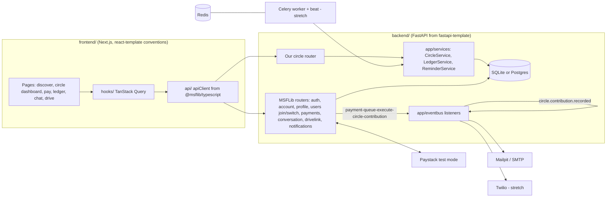
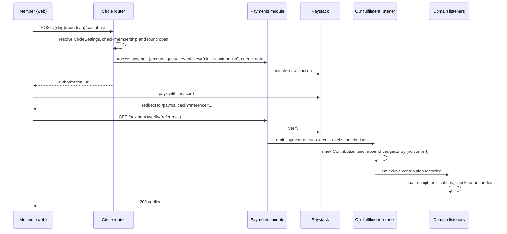

# AjoHub — Technical Plan

Digital rotating savings circles (ajo / esusu / adashi) built on MSFLib.

## 1. The product

### Problem
Millions of people save through ajo: a group agrees to contribute a fixed amount every
week or month, and each round one member collects the whole pot. Today it runs on
WhatsApp groups, a notebook, and trust in one coordinator. The common failures are:

- No reliable record of who paid what, so disputes are settled by memory.
- Late or missing contributions are discovered only when the payout is short.
- The coordinator holds all the information and can disappear.
- A member's years of disciplined saving leave no proof they can show a bank or lender.

### Solution
AjoHub turns each circle into a shared, transparent space:

1. A coordinator creates a circle and sets its rules (amount, frequency, size, late fee).
2. Members join while the circle is recruiting. When it starts, membership locks and a
   payout order is generated.
3. Each round, members pay their contribution through Paystack. Verified payments are
   written to an append-only ledger automatically.
4. Every payment posts a receipt into the circle's group chat and notifies the member and
   coordinator.
5. When a round is fully funded, the coordinator pays out the recipient and uploads proof
   of transfer to the circle's shared drive.
6. Any member can download a savings statement showing their full contribution history.

### Demo story (3 minutes)
1. Ada creates "Lagos Traders Circle": ₦5,000 weekly, 4 members, ₦500 late fee.
2. Three members join from the discover page; Ada starts the circle. Joining now fails
   (the circle is locked), and the payout order appears.
3. Bola pays round 1 with a Paystack test card. Within seconds: ledger updated, chat
   receipt posted, Bola and Ada notified, round progress bar moves.
4. Remaining members pay; the round flips to "ready for payout"; recipient is notified.
5. Ada uploads the transfer receipt; round marked paid out; next round opens.
6. "Simulate next week" button: reminders go out, an unpaid member gets a late fee.
7. Bola downloads her savings statement.

## 2. Why this is meaningful MSFLib use

This is the slide for judges. Each row is a place where the product depends on a
module's behaviour, not just its import.

| MSFLib feature | How AjoHub uses it |
|---|---|
| `msflib-workspaces` | A circle **is** a workspace. Membership types (`owner`, `admin`, `member`) are circle roles. Workspace `status` is the circle lifecycle: `open` (recruiting, join allowed), `restricted` (active, join refused with 423), `readonly` (completed). |
| Workspace membership events | A listener on `workspace-membership-pre-create` (a strict event: raising aborts the join) enforces the circle's `MAX_MEMBERS`. A listener on `workspace-membership-created` adds the member to the circle chat and notifies the coordinator. |
| `WorkspaceAction.create_with_owner` | Our own "create circle" endpoint, because the stock `POST /workspaces/` is restricted to account admins. |
| `msflib-workspace-config` (tiered config) | Circle rules are a `CircleSettings` namespace. Platform defaults live at **tenant** tier, each circle's rules at **workspace** tier, each member's reminder preferences at **user** tier. Every read goes through `resolve_module_settings`. |
| `msflib-payments` | Contributions use `process_payment(queue_event_key="circle-contribution", queue_data={...})`. The fulfilment listener on `payment-queue-execute-circle-contribution` writes the ledger. Amount-mismatch and ownership checks come free from the verify route. |
| Event bus | Our own domain events chain the side effects: `circle.contribution.recorded` → chat receipt + notifications + "is the round complete?" check → `circle.round.funded`. |
| `msflib-notifications` | `dispatch_account_notifications` for in-app (always), email (Mailpit locally) and SMS (Twilio, stretch). |
| `msflib-conversation` | Each circle gets a channel. A "ledger bot" participant posts payment receipts. A custom resource kind `payment` (registered in `RESOURCE_KIND_REGISTRY`) links receipts to the payment record. |
| `msflib-drivelink` | Each circle has a workspace-scoped drive: the circle agreement, plus one folder per round holding payout proof. |
| Core actions, seeding, auth deps | All our tables use `ModelAction` subclasses; demo data via MSFLib seeding; every endpoint uses the template's auth and workspace dependencies. |
| React modules | `@msflib/react-workspace` (circle list/switch), `@msflib/react-notification` (bell + inbox), `@msflib/react-profile`, `@msflib/react-components` (`FormBuilder`, tables, chat UI kit). |

## 3. Architecture



### Contribution flow (the core loop)



## 4. Repository layout

```
hackathon/
  PLAN.md
  backend/                     # cloned from the MSFLib FastAPI template
    app/
      main.py                  # + bind emitter (already), mount our routers
      bootstrap.py             # + register our listeners and module hooks
      core/config.py           # + Payments, Notifications, WorkspaceConfig, Conversation, Drivelink settings, Twilio fields
      models/
        __init__.py            # + re-export our tables and the extra module tables
        circle.py              # Round, Contribution, LedgerEntry, PayoutSlot
      settings_ns/circle.py    # CircleSettings (tiered config namespace)
      actions/circle.py        # RoundAction, ContributionAction, LedgerAction
      services/
        circle_service.py      # create, start, payout order, round state machine
        ledger_service.py      # append-only ledger, member statement
        reminder_service.py    # reminders and late-fee pass (used by beat and the demo button)
      eventbus/
        payments.py            # payment-queue-execute-circle-contribution
        circle.py              # circle.contribution.recorded, circle.round.funded
        membership.py          # workspace-membership-pre-create / -created
      api/api_v1/endpoints/
        circles.py             # our router
      seed/                    # demo circles and members
  frontend/                    # Next.js app following @msflib/react-template conventions
    app/(public)/discover, (auth)/login, (protected)/circles/[slug]/...
    api/circles.ts  hooks/useCircle.ts  types/circle.ts  columns/ledger.ts  data/forms/
```

## 5. Backend design

### 5.1 Settings

Extend the template's `AppSettings` with the extra module settings. Use **flat**
environment variable names: the docs note `NAMESPACE__KEY` only works for settings
composed as fields (#280), and the template subclasses.

```python
class AppSettings(
    PaymentsSettings, NotificationSettings, WorkspaceConfigSettings,
    ConversationSettings, DrivelinkSettings,
    WorkspaceSettings, TenancySettings, AccountSettings, AuthSettings, CoreSettings, SettingsBase,
):
    TWILIO_ACCOUNT_SID: str = ""     # not declared by any MSFLib class (#274)
    TWILIO_AUTH_TOKEN: str = ""
    TWILIO_PHONE_NUMBER: str = ""
```

Required environment: `SECRET_KEY` (fixed, never random), `PAYSTACK_SECRET_KEY`
(test key), `PAYMENT_GATEWAY=paystack`, `PAYMENT_CALLBACK_URL=http://localhost:3000/pay/callback`,
`CLIENT_HOST`, SMTP pointing at Mailpit (`localhost:1025`) or `EMAILS_ENABLED=false`.

### 5.2 Circle rules as tiered config

```python
class CircleSettings(ModuleSettingsBase):
    namespace: ClassVar[str] = "CIRCLE"
    request_override_allowlist: ClassVar[set[str]] = set()   # no per-request overrides of money rules
    CONTRIBUTION_AMOUNT: int = 5000          # naira, major units (matches PaymentData)
    FREQUENCY: str = "weekly"                # weekly | monthly
    MAX_MEMBERS: int = 10
    LATE_FEE: int = 0
    GRACE_DAYS: int = 1
    PAYOUT_ORDER: str = "random"             # random | join_order
    REMINDER_CHANNELS: list[str] = ["inapp", "email"]
```

- Tenant tier: platform defaults (e.g. `MAX_MEMBERS=20`, `REMINDER_CHANNELS`).
- Workspace tier: the coordinator's rules, written when the circle is created, editable
  only while `status == open`.
- User tier: a member's own `REMINDER_CHANNELS` (e.g. add `sms`).

### 5.3 Our tables (all `ModelAction`-backed)

| Table | Key fields |
|---|---|
| `PayoutSlot` | `workspace_id`, `account_id`, `position` (unique per workspace) |
| `Round` | `workspace_id`, `number`, `opens_at`, `due_at`, `recipient_account_id`, `status` (`upcoming`, `collecting`, `funded`, `paid_out`), `payout_proof_node_id` (drivelink node) |
| `Contribution` | `workspace_id`, `round_id`, `account_id`, `amount`, `late_fee`, `status` (`pending`, `paid`, `late`, `waived`), `payment_id` (FK `payment.id`), `paid_at`; unique `(round_id, account_id)` |
| `LedgerEntry` | append-only: `workspace_id`, `account_id`, `round_id`, `kind` (`contribution`, `late_fee`, `payout`), `amount`, `reference`, `created_at`; unique `(kind, reference)` so a retried verify cannot double-post |

Store money as integers in naira (the payments module takes major units and converts to
kobo itself).

### 5.4 Endpoints (our router)

Workspace-scoped routes use the template's path resolver, so they live under
`/api/v1/{workspace_slug}/...` and depend on `user_deps.get_current_workspace` and
`user_deps.get_current_active_user`.

| Method and path | Who | Does |
|---|---|---|
| `POST /circles` | any signed-in account | `workspace_action.create_with_owner`, write `CIRCLE` workspace config, create chat channel, create drive folder |
| `GET /circles/discover` | anyone | open circles with resolved rules and seats left |
| `POST /users/join` | member | **MSFLib route**; our pre-create listener enforces `MAX_MEMBERS` |
| `GET /{slug}/circle` | member | summary: rules, members, current round, totals |
| `PUT /{slug}/circle/rules` | owner, while open | update workspace-tier config |
| `POST /{slug}/circle/start` | owner | set status `restricted`, build payout order, create rounds, open round 1 |
| `GET /{slug}/rounds` | member | rounds with contribution status per member |
| `POST /{slug}/rounds/{n}/contribute` | member | `process_payment`, return `authorization_url` |
| `GET /payments/verify/{reference}` | member | **MSFLib route**; triggers our fulfilment listener |
| `POST /{slug}/rounds/{n}/payout` | owner | multipart proof upload into drivelink, mark `paid_out`, ledger `payout`, open next round, set `readonly` after last round |
| `GET /{slug}/ledger` | member | ledger entries (table on the frontend) |
| `GET /{slug}/members/me/statement` | member | savings statement (JSON; frontend renders printable view) |
| `PUT /{slug}/me/preferences` | member | user-tier config (reminder channels) |
| `POST /{slug}/demo/advance` | owner, `DEMO_MODE` only | run `ReminderService` as if the due date passed |

Role checks use `user_deps.WorkspaceRoleCheck(["owner", "admin"])`. Pass both: the
check compares the membership type exactly, and `["admin"]` alone refuses the owner.

### 5.5 Event listeners

All registered on the **app emitter** in `bootstrap_module_hooks` (never the module-level
`emitter`, or payments reports "handler is not registered").

| Event | Listener |
|---|---|
| `workspace-membership-pre-create` | resolve `CIRCLE` config; raise if seats are full or circle not `open` (strict event: aborts the join) |
| `workspace-membership-created` | add member to circle channel; notify owner "X joined" |
| `payment-queue-execute-circle-contribution` | load `Contribution` from `queue.data`; mark paid; append ledger rows (contribution and any late fee); **do not commit** (the router commits); emit `circle.contribution.recorded` |
| `circle.contribution.recorded` | post receipt to chat with a `payment` resource link; notify member and owner; if every contribution in the round is paid, mark `funded` and emit `circle.round.funded` |
| `circle.round.funded` | notify recipient and owner |

### 5.6 Reminders and late fees

`ReminderService.run(now)`:
- rounds due within 24h: notify unpaid members over their resolved `REMINDER_CHANNELS`;
- rounds past `due_at + GRACE_DAYS`: mark unpaid contributions `late`, add `LATE_FEE`.

MVP calls it from the demo button. Stretch: a Celery beat schedule calls it hourly.

## 6. Frontend design

Scaffold:

```bash
npx @msflib/react-template web
```

Answers: GitHub workflows **no**; multi-tenant **yes**, **path-based** (circle routes are
`/{workspace_slug}/...` on the backend); optional modules: `react-profile`,
`react-notification` (`react-workspace` comes with multi-tenant). Requires `.npmrc` with
`@msflib:registry=https://npm.pkg.github.com` and a `GITHUB_TOKEN` with `read:packages`.

Pages:
- `(public)/discover` — open circles, seats left, rules; Join button.
- `(auth)/login`, `(auth)/register` — `@msflib/react-auth` / template defaults.
- `(protected)/circles/new` — `FormBuilder` form for rules.
- `(protected)/circles/[slug]` — dashboard: current round progress, who has paid, next
  recipient, Pay button, owner controls (start, payout, simulate next week).
- `(protected)/circles/[slug]/ledger` — table of ledger entries.
- `(protected)/circles/[slug]/chat` — chat UI kit from `@msflib/react-components` over the
  conversation routes.
- `(protected)/circles/[slug]/drive` — agreement and payout proofs.
- `(protected)/circles/[slug]/statement` — printable savings statement.
- `/pay/callback` — reads `reference`, calls verify, redirects to the dashboard.

Data layer per the template convention: `types/circle.ts` → `api/circles.ts`
(`apiClient`) → `hooks/useCircle.ts` (TanStack Query, invalidate circle and ledger queries
after verify) → pages.

## 7. Risks and how we avoid them

| Risk (from the docs) | Mitigation |
|---|---|
| Stock `POST /workspaces/` needs account role `admin` | Own `POST /circles` using `create_with_owner` |
| 500 "Default tenant has not been seeded" (#288) | Keep slug `default`, seed at startup, pass `get_current_tenant` built with `settings.scope("TENANCY")` |
| `NoReferencedTableError` on table creation | Import account, tenant, workspace, payments, conversation, drivelink, workspace_config models in `app/models/__init__.py` before `create_all` / Alembic |
| `msflib-payments` and `msflib-workspace-config` miss declared deps (#273, #279) | Add `msflib-account` and `msflib-workspaces` explicitly in `pyproject.toml` |
| Fulfilment never runs | Listener on the app emitter; verify retry re-emits if the queue is still `queued` |
| Double-posting on retries | Unique constraints on `Contribution(round_id, account_id)` and `LedgerEntry(kind, reference)` |
| Conversation services commit themselves | Never call them inside a `*-pre-commit` listener; call them from post-commit events or our services |
| Payments has no payouts, webhooks or refunds | Payouts are recorded manually with proof upload (honest about it in the pitch); verify is pull-based via the callback page |
| SMS silently does nothing (#274) | Declare `TWILIO_*` fields; SMS is stretch only |
| Email "sent" with no server | Run Mailpit (`docker run -p 8025:8025 -p 1025:1025 axllent/mailpit`) and show its inbox in the demo |
| `@msflib/react-certificate` / `react-support` may need backend modules that are not in the FastAPI package list | Do not depend on them; statement is our own page |
| Packages come from git and GitHub Packages | Pin tags in `pyproject.toml`; set up `GITHUB_TOKEN` in hour 0 |

## 8. 24-hour build schedule (solo)

| Hours | Goal | Done when |
|---|---|---|
| 0–2 | Setup | Template backend runs, `/docs` shows login; Redis and Mailpit in Docker; Paystack test keys; web scaffold runs and logs in against the backend |
| 2–5 | Circles | `CircleSettings`, `POST /circles`, discover, join with seat-limit listener, start with payout order and rounds |
| 5–9 | Money loop | `contribute` → Paystack → `/pay/callback` → verify → listener → ledger. **Highest-risk step; test with a real Paystack test card** |
| 9–11 | Side effects | Chat channel + ledger-bot receipts, in-app and email notifications, round funded event |
| 11–16 | Frontend | Discover, create form, dashboard, pay flow, ledger table, notifications bell |
| 16–18 | Payout and drive | Proof upload to drivelink, round transitions, circle completion |
| 18–20 | Demo tooling | `demo/advance` (reminders + late fee), seed script with two realistic circles |
| 20–22 | Polish | Statement page, empty and error states, mobile layout check |
| 22–24 | Submission | README with the "meaningful use" table and diagrams, record demo video |

**Cut line if behind at hour 12:** drop chat UI (keep receipts as notifications), drop
drive (store proof note as text), drop statement page. Never cut the money loop or the
lifecycle/seat-limit logic; they are the core of the MSFLib story.

**Stretch (only if ahead):** Celery beat reminders, Twilio SMS, Discord announcements via
`msflib-workspace-notifications`, bid-based payout order, Postgres instead of SQLite.

## 9. Open items to confirm in hour 0

- The FastAPI template repo URL and how it pins MSFLib versions.
- Whether `PathParameterResolver` expects `{workspace_slug}` for all workspace-scoped routes
  in the template's `user_deps`.
- How the conversation router expects a "system" or bot sender (we plan an agent
  participant named `ledger-bot`).
- What `@msflib/react-workspace` and the chat UI kit expect from the backend (endpoint
  shapes), so the frontend can reuse them instead of custom components.
